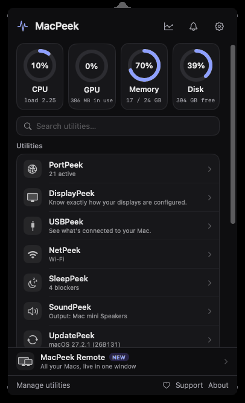
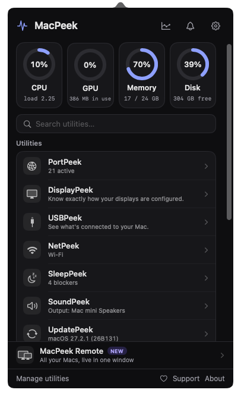
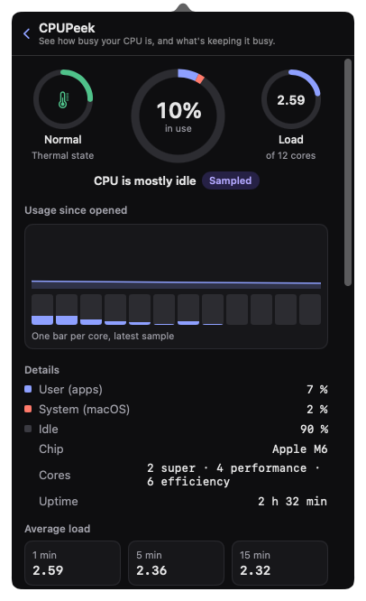
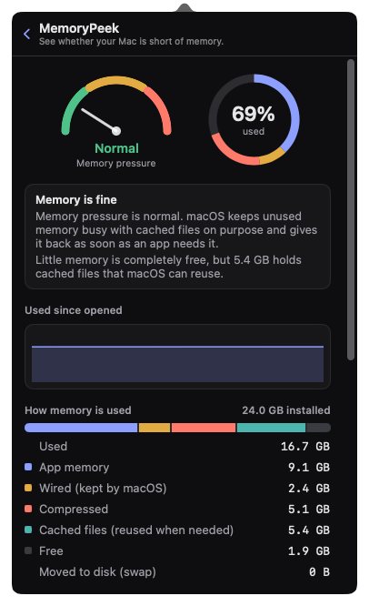
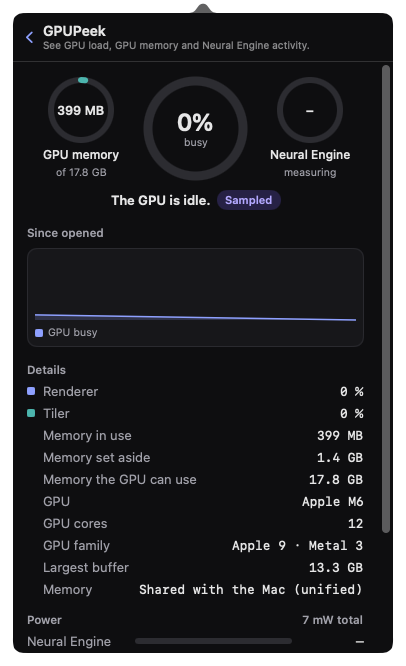
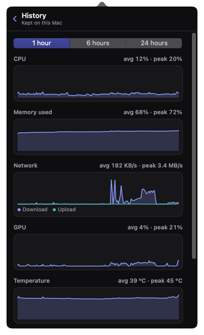
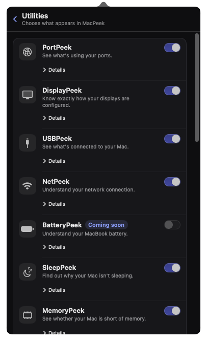
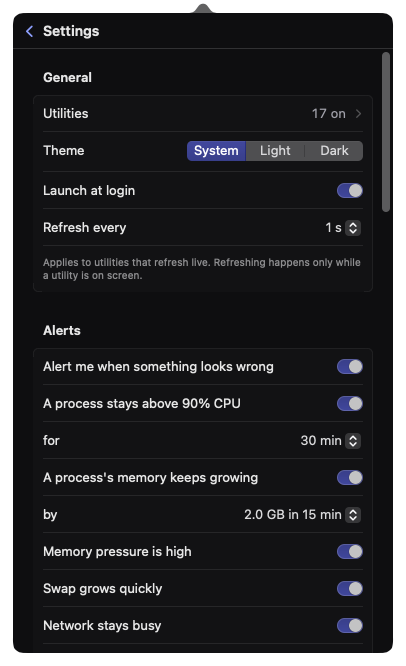
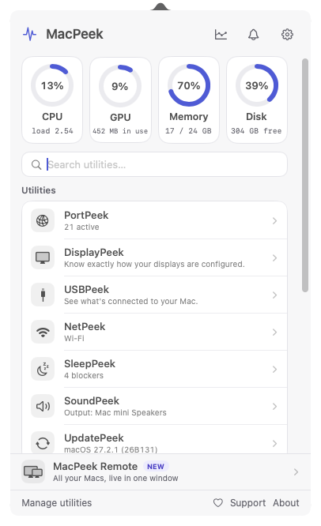

# MacPeek

**The tiny utilities macOS should have built in.**

MacPeek is a native, lightweight, open-source collection of focused macOS menu-bar utilities for finding,
inspecting and understanding the things macOS makes unnecessarily difficult to see. One small app, many
**Peeks** — switch on the ones you want, switch off the rest.

[](https://github.com/sponsors/mohitkap12-a11y)

<p align="center">
  
</p>

## Screenshots

| Launcher | CPUPeek | MemoryPeek |
|---|---|---|
|  |  |  |

| GPUPeek | 24-hour history | Manage utilities |
|---|---|---|
|  |  |  |

| Settings | Light mode |
|---|---|
|  |  |

## Utilities

| Utility | Answers | Status |
|---|---|---|
| **PortPeek** | What is using port 3000? Free it safely. | ✅ Available |
| **DisplayPeek** | What display configuration am I actually running? | ✅ Available |
| **USBPeek** | What is connected, and at what speed? | ✅ Available |
| **NetPeek** | Is my network connection actually healthy? | ✅ Available |
| **BatteryPeek** | What is my MacBook battery actually doing? | Coming soon |
| **SleepPeek** | Why isn't my Mac sleeping? | ✅ Available |
| **MemoryPeek** | Is my Mac actually running out of memory? | ✅ Available |
| **CPUPeek** | What is making my Mac slow or hot right now? | ✅ Available |
| **FileLockPeek** | What process is using this file? | ✅ Available |
| **ProcessPeek** | What exactly is this process? | ✅ Available |
| **DiskPeek** | Which app is using my disk right now, and how full is each drive? | ✅ Available |
| **EnvPeek** | What environment variables does this environment see? | ✅ Available |
| **DNSPeek** | Which DNS servers is my Mac using, and do they respond? | ✅ Available |
| **SoundPeek** | Why is my audio going to the wrong place? | ✅ Available |
| **UpdatePeek** | What updates are available? | ✅ Available |
| **GPUPeek** | How busy are my GPU and Neural Engine, and who is using them? | ✅ Available |
| **ContainerPeek** | Which containers and VMs are running, and what are they costing me? | ✅ Available |
| **ModelPeek** | Which local LLMs are loaded, and how much memory and GPU are they using? | ✅ Available |

Open MacPeek's menu-bar icon to see the launcher. **Manage utilities** (or Settings → Manage utilities) lists
every utility with a description, what it reads, what access it needs, and an on/off switch. A utility that
is switched off does no work at all: no polling, no scanning, nothing in the launcher.

## Features
- Native Swift/SwiftUI, menu-bar only (no Dock icon), light/dark/system appearance (switch from the launcher's sun/moon button)
- One launcher: CPU, Memory and Disk rings at the top, every other utility listed below with its summary and a search, one consistent compact UI
- **Safe process termination** shared by every utility that can kill something: re-check the target →
  verify the PID still owns the resource and is the same process (PID-reuse guard) → SIGTERM → verify
  exit and release → optional, explicit force kill (SIGKILL) after another re-check
- Utilities refresh only while their screen is open
- **Alerts** (on by default): a process stuck at high CPU, a process whose memory keeps growing, memory pressure, fast swap
  growth, sustained network traffic and heat, in Notification Center and under the launcher's bell, each with its own
  switch and threshold and **Don't Alert About This App**
- **Menu-bar readout** (off by default): CPU, memory, network ↓↑, GPU and temperature next to the icon, in a readable
  monospaced font, orange/red when they need attention
- **24-hour history** (on by default, kept on this Mac): CPU, memory, network, GPU, temperature and power charts for the
  last 1, 6 or 24 hours
- **Temperatures, fans and power** in CPUPeek and GPUPeek, read-only, no administrator rights
- **App helpers grouped**: browser tabs and Electron helpers listed under their app in CPUPeek and ProcessPeek, with where
  the browser shows which tab is busy
- If macOS hides the menu-bar icon (full menu bar, or the notch), MacPeek says so once and opens in a window when launched
  again. Details: [docs/alerts-and-history.md](docs/alerts-and-history.md)
- No account, no telemetry, no cloud. One third-party dependency: [Sparkle](https://sparkle-project.org) for in-app updates. The network traffic is a once-a-day check of GitHub for a new MacPeek release (switch it off in Settings) and checks you start yourself (NetPeek pings, DNSPeek lookups, UpdatePeek's macOS and npm checks). ModelPeek asks Ollama's and LM Studio's APIs on 127.0.0.1 while they run, which never leaves your Mac. Remote management, for the separate MacPeek Remote console, is off unless you turn it on

## Install
Download `MacPeek-x.y.z.dmg` from [Releases](../../releases/latest), drag **MacPeek** to **Applications**,
launch it and look for the icon in the menu bar. Releases are Developer ID signed and notarized; verify the
download against the published `SHA256SUMS`.

## Build from source
Requires macOS 13+ and **full Xcode 15+** (Swift 5.9). The standalone *Command Line Tools* are not enough:
SwiftUI's `@State` macro needs the `SwiftUIMacros` plugin that only Xcode ships. If you see
`plugin for module 'SwiftUIMacros' not found`, run
`sudo xcode-select -s /Applications/Xcode.app/Contents/Developer`
(see [Troubleshooting the build](CONTRIBUTING.md#troubleshooting-the-build)).

```bash
swift build
swift test
swift run MacPeek            # runs the menu-bar app
open Package.swift           # or open it in Xcode
scripts/build-app.sh 0.1.0   # build/MacPeek.app (ad-hoc signed unless SIGN_IDENTITY is set)
MACPEEK_ENV=staging scripts/build-app.sh 0.1.0   # the same, with Add to my account and the relay on the staging service
scripts/make-dmg.sh 0.1.0    # dist/MacPeek-0.1.0.dmg + SHA256SUMS
```

## Architecture
```text
MacPeek (menu-bar app)                      Sources/MacPeek
 ├─ Shell: launcher · router · utility manager · settings · about
 ├─ SharedUI: PeekHeader · PeekRow · StatusBadge · EmptyState · CopyButton …
 └─ Utilities/<Name>/  view + module for each utility
MacPeekCore (shared, UI-free)               Sources/MacPeekCore
 └─ ProcessTerminationService · PermissionService · ProcessInspecting · ProcessUsageReader · ShellCommand · UtilityCatalog
<Name>Kit (one per utility, UI-free)        Sources/PortPeekKit, …
 └─ models · parsers · discovery · services — unit-tested with fixtures
```
The shell knows only utility metadata and navigation; each utility owns its models, services, views and tests.
Details: [docs/architecture.md](docs/architecture.md). Adding a utility: [CONTRIBUTING.md](CONTRIBUTING.md#adding-a-utility).

## Security model
MacPeek runs as your user and never elevates privileges. It can only see and terminate what your user can.
Termination never trusts a stale PID. Details: [SECURITY.md](SECURITY.md).

## Privacy
No account, no telemetry, no cloud. MacPeek reads local system information to show it to you and never
transmits it. MacPeek asks GitHub about once a day whether a newer release exists (Settings → Check for updates automatically; update downloads are verified with an EdDSA signature). Otherwise the only network traffic is what you ask for: NetPeek's pings, DNSPeek's lookups and UpdatePeek's macOS and npm
checks (Apple's update servers and the npm registry), each run only when you press the button. Each utility documents exactly what it reads (see Manage utilities).

Alerts, the menu-bar readout and the 24-hour history are worked out on this Mac by one background monitor that runs only
while one of them is on (a few cheap reads every 5 seconds, a process scan every 10); the history file stays in
`~/Library/Application Support/MacPeek`. Temperatures, fans and power are read through interfaces Apple does not document,
read-only.

**Remote management** (Settings → Remote management) is off by default. While it is off MacPeek does not listen, does not
advertise itself and connects nowhere. To manage this Mac from MacPeek Remote, turn it on and choose **Add to my
account…**: sign in to your MacPeek Remote account in the browser, then approve the Mac in MacPeek Remote on your main
Mac. Only devices of that account can then connect, over end-to-end encrypted connections checked against the account
key the Mac pinned, on the local network or, with **Allow from anywhere** (turned on when the Mac joins, and said so),
from any network through MacPeek's relay, which sees only which Mac and which of your devices connect, addresses, times
and amounts of data. Actions (freeing a port, quitting a process) need a separate **Allow actions** switch, use the same
safety checks as on the Mac, and are recorded in an activity log you can read in Settings. A menu-bar dot shows whenever
Remote management is on. The protocol is described in [docs/remote.md](docs/remote.md).

## Roadmap
Seventeen utilities are built (PortPeek, FileLockPeek, DisplayPeek, USBPeek, SleepPeek, MemoryPeek, CPUPeek, ProcessPeek, DiskPeek,
EnvPeek, NetPeek, DNSPeek, SoundPeek, UpdatePeek, GPUPeek, ContainerPeek, ModelPeek); 0.5.0 adds alerts, the menu-bar readout, 24-hour history, sensors and helper grouping. BatteryPeek is next (it needs a
capture from a MacBook), then global search, accessibility and localization
polish → signed releases.

## Contributing / License
See [CONTRIBUTING.md](CONTRIBUTING.md) and [CODE_OF_CONDUCT.md](CODE_OF_CONDUCT.md). Licensed under the [MIT License](LICENSE).
